I'm an AI engineer working in the biomedical field, specializing in protein engineering.

### Skills

**Protein AI & Structural Modeling** 
`AlphaFold 3` `RFdiffusion` `ESM-2 / ProtTrans` `ProteinMPNN` `PyRosetta` `OpenMM` `BioPython`

**Deep Learning Frameworks** 
`PyTorch` `PyTorch Geometric (PyG)` `JAX` `Deep Graph Library (DGL)` `CUDA` `Hugging Face`

**Bioinformatics & Multi-Omics** 
`Single-Cell RNA-seq (scanpy, Seurat)` `Immune Repertoire (tcrdist3, MiXCR)` `PyMOL` `BLAST` `Immunogenicity Prediction (NetMHCpan)`

**MLOps & Infrastructure** 
`Linux/HPC (SLURM)` `AWS (Batch, SageMaker)` `Docker` `Nextflow` `Weights & Biases (W&B)` `Git`
