I'm building **[ReSauce](https://github.com/shreyandhawa/ReSauce)**, a research proof of concept.

Clinical research records are filled in by people who copy values out of medical notes, and a copying mistake can end up in a study. ReSauce reads the documents behind a record, picks out the observations that matter, puts the events in order and shows where the record and the documents disagree. Each finding comes with the exact quoted text it rests on, so a person can check it.

The first use case is ICANS, a neurological side effect that can follow CAR-T cell therapy.

### What I'm working on now

Turning ReSauce into an engine that can hold many checking pipelines, pick the ones that fit a dataset and run them on your own computer, so clinical data never leaves the device.

### Ground rules

- Synthetic (made-up) data only. No real patient data.
- No invented results. If something isn't known, it says so.
- Every finding links back to its source.

### Built with

Python · React · Vite
