I'm a computer science student at the University of Southern Mississippi doing bioinformatics research. I build AI tools, some for biology and some for everyday life.

### Projects

- **[Arohexis](https://github.com/shreyandhawa/arohexis)**: a local-first app that trains the moment of starting. Installable, works offline, keeps your data on your device.
- **TruStory** (private): a local tool that compares statements against versioned evidence and exports findings with exact source references. Built for USM's Mississippi AI Innovation Hub.
- **[lumenCell](https://github.com/shreyandhawa/lumenCell_V2)**: an interactive explorer for pseudotime and lineage trajectories in single-cell RNA-seq data.

### Skills

**Single-cell & bioinformatics** 
`scanpy` `AnnData` `PAGA + DPT` `Palantir` `scFates` `NumPy` `SciPy` `pandas`

**Languages** 
`Python` `TypeScript` `SQL`

**Backend** 
`FastAPI` `SQLAlchemy` `pydantic` `Typer` `SQLite`

**Frontend** 
`React` `deck.gl` `Dexie / IndexedDB` `Vite` `Valibot`

**Speech & ML tooling** 
`Hugging Face Transformers` `wav2vec2` `Whisper` `Azure Speech`

**Testing & tooling** 
`pytest` `Hypothesis` `Vitest` `Playwright` `mypy (strict)` `Git` `GitHub Actions` `uv`

**Learning now** 
`neural network fundamentals` `protein language models (ESM-2)` `TCR repertoire analysis`
